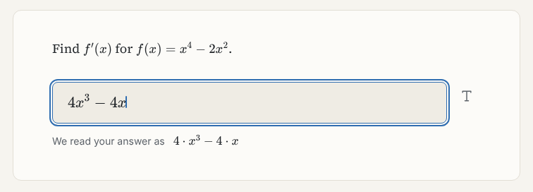
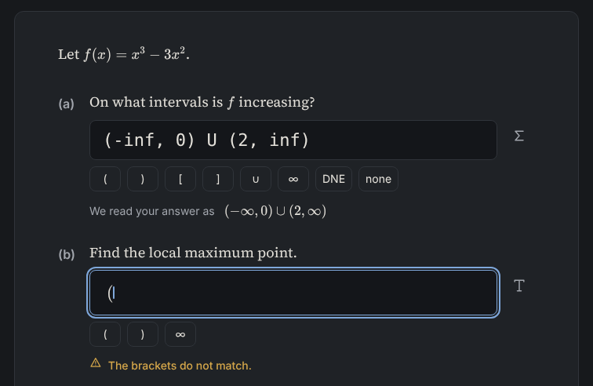
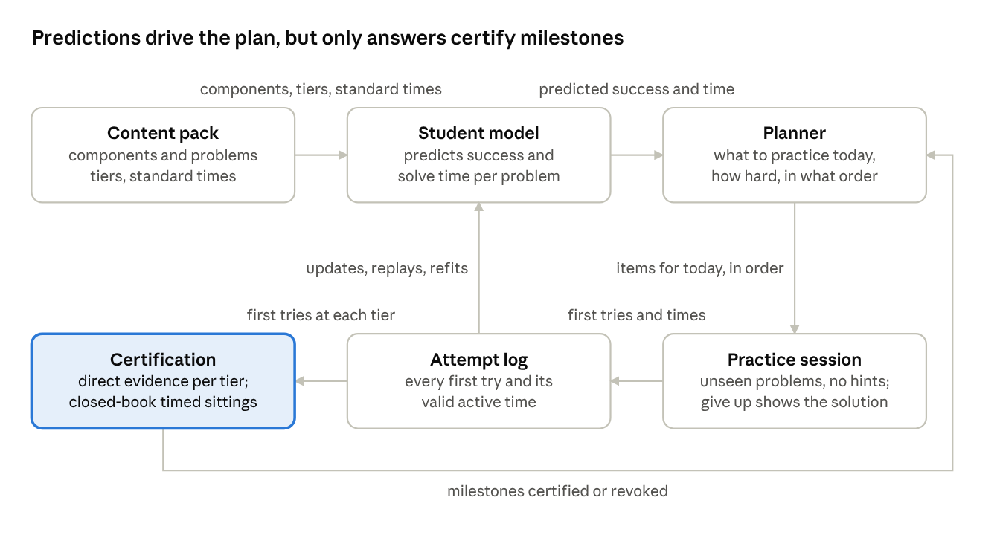

# Toishi

**砥石 (toishi): a whetstone.** A free, offline Mac app that turns what you understood in class into skill you can use on an exam, through practice alone.

<p align="center">
  
</p>

The textbook and lectures teach. Toishi serves unseen problems, checks your typed answers exactly with computer algebra, and decides what you should practice next. It starts with college Calculus I and is built for any STEM course.

## What it does

- **You solve real problems from scratch.** Type math the way you'd write it. The app shows how it read your answer, then checks it exactly with computer algebra. Intervals, points, sets and multi-part problems all work.
- **Practice stays practice.** During a problem there are no hints and no explanations. A wrong answer shows "Not quite", and you can retry. Giving up shows the full worked solution.
- **A student model plans every day.** It predicts your chance on every problem from the skills the problem needs, how much you've practiced each one and how long ago, and it updates after every first try. A day is one mixed session of new material, problems at the edge of your ability, and spaced review.
- **The bar is above the exam.** Each skill has three targets:
  - **accuracy:** 90% correct on the first try, on problems you haven't seen;
  - **difficulty:** above a strong university's standard exam;
  - **pace:** fast enough to finish an exam in its time.

  Exam-level milestones are certified only in closed-book, timed sittings.
- **When you're stuck, the problem changes.** It becomes a smaller problem first, then a problem on the prerequisite you're missing. Then the skill is set aside until tomorrow, with a pointer to its textbook section.
- **Honest about the cost.** The app shows the day's work in minutes and the hours per week needed to keep pace with the course. It never lowers the targets to fit.
- **Flashcards too.** Definitions and formulas run on FSRS-6, as in Anki, and Anki decks can be imported.
- **Nothing leaves your Mac.** No account, no network connection and no AI at runtime. Your progress lives in one SQLite file per profile.

<p align="center">
  
</p>

## How it works

<p align="center">
  
</p>

**The model predicts, but only your answers certify.**
- Every problem lists the components it needs: the procedures, rules and setup moves of its solution. For each component, the model tracks how reliably you carry it out and how well you remember it.
- The model decides what to practice and when to review. A milestone counts as reached only when your own first tries at that difficulty show it.
- **Deadlines follow a real course:**
  - homework level 5 days after a skill is introduced;
  - exam level by 14 days;
  - the target level by 28 days.

  These come from the syllabi of 14 university Calculus I courses.
- **Tested against real data.** Every assumption was tested against public learning logs (CMU OLI Statics and the XES3G5M math dataset). The planner is tested against simulated students drawn from several competing models of learning.

The full design is in [docs/design/student-model.md](docs/design/student-model.md). The checks against real data are in [docs/design/model-assumption-audit.md](docs/design/model-assumption-audit.md) and [docs/design/external-audit-response.md](docs/design/external-audit-response.md), and the research behind the decisions is in [docs/research/](docs/research/).

## Status

Early development, with no release yet. Requires macOS 14+ on Apple silicon.

- **Built:**
  - the answer checker;
  - the study screen;
  - flashcards with Anki import;
  - storage with crash safety and backups;
  - the student model, certification and the practice planner.
- **In progress:**
  - wiring the new planner into the study screens;
  - the Calculus I problem pack, written section by section and independently reviewed before it ships.

## Installing a release

Releases will be on this repository's Releases page. The app is ad-hoc signed, not notarized (no paid Apple developer account), so macOS blocks the first launch: open it once, then go to System Settings → Privacy & Security and click **Open Anyway**.

## Building from source

```bash
curl -LsSf https://astral.sh/uv/install.sh | sh   # uv; Node.js 22.12+ too
uv python install 3.14 && uv sync && npm --prefix web ci
npm --prefix web run build && uv run python -m app
```

Checks, the app build, and the rest of the developer workflow are in [docs/development.md](docs/development.md). Rules for contributing are in [AGENTS.md](AGENTS.md). Architecture decisions are in [docs/decisions/](docs/decisions/).

## License

The code is free software under the [GNU General Public License v3.0 or later](LICENSE). Course packs carry their own licenses, listed in each pack. The Calculus I pack is CC BY-NC-SA 4.0, built from openly licensed textbooks and original problems.
