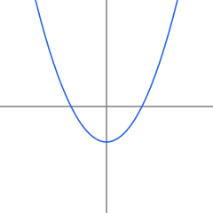

<!-- set -->
## Card test.quad.solve.001
skill: test.alg.quadratic-solve
uses: test.alg.factor-quadratic, test.alg.linear-solve
difficulty: 2
answer-type: set
answer: 2, 3
wrong: -2, -3 => (x - 2)(x - 3) is zero at x = 2 and x = 3. @2; 2 => There are two solutions. @2

### Question
Solve \(x^2 - 5x + 6 = 0\).

### Hints
1. Find two numbers that multiply to \(6\) and add to \(-5\).

### Solution
0. [test.alg.quadratic-solve] Set up: factor, then set each factor equal to zero.
1. [test.alg.factor-quadratic] Factor: \((x - 2)(x - 3) = 0\).
2. [test.alg.linear-solve] Solve: \(x = 2\) or \(x = 3\).

<!-- list -->
## Card test.quad.coefficients.001
skill: test.alg.quadratic-formula
difficulty: 1
answer-type: list
answer: 2, -3, 7
wrong: 2, 3, 7 => Keep the sign: the middle term is -3x. @1; 7, -3, 2 => a goes with x^2, b with x, c is the constant. @1

### Question
List the coefficients \(a\), \(b\), \(c\) of \(2x^2 - 3x + 7\), in that order.

### Hints
1. Compare with \(ax^2 + bx + c\).

### Solution
0. [test.alg.quadratic-formula] Set up: match the terms of \(ax^2 + bx + c\).
1. [test.alg.quadratic-formula] Read off: \(a = 2\), \(b = -3\), \(c = 7\).

<!-- interval -->
## Card test.quad.inequality.001
skill: test.alg.quadratic-solve
uses: test.alg.factor-quadratic
difficulty: 3
answer-type: interval
answer: (-2, 2)
wrong: [-2, 2] => The inequality is strict, so the endpoints are not included. @2; (-inf, -2) U (2, inf) => That is where x^2 - 4 is positive. @2

### Question
Solve \(x^2 - 4 < 0\). Write the answer in interval notation.

### Hints
1. Where is \(x^2 - 4 = 0\)?
2. Test a number between the zeros.

### Solution
0. [test.alg.quadratic-solve] Set up: find the zeros, then test the sign between them.
1. [test.alg.factor-quadratic] Factor: \((x - 2)(x + 2) < 0\).
2. [test.alg.quadratic-solve] Sign: the product is negative between the zeros, so \(-2 < x < 2\), that is \((-2, 2)\).

<!-- point -->
## Card test.quad.vertex.001
skill: test.alg.vertex
difficulty: 1
answer-type: point
answer: (1, 3)
wrong: (-1, 3) => In (x - h)^2 + k the vertex is (h, k), so h = 1. @1

### Question
Find the vertex of the parabola \(y = (x - 1)^2 + 3\).

### Hints
1. Compare with \(y = (x - h)^2 + k\).

### Solution
0. [test.alg.vertex] Set up: the vertex of \(y = (x - h)^2 + k\) is \((h, k)\).
1. [test.alg.vertex] Read off: \(h = 1\), \(k = 3\).

<!-- multi-part: a set, a point and a choice, with an image -->
## Card test.quad.parabola.001
skill: test.alg.quadratic-solve
uses: test.alg.factor-quadratic, test.alg.vertex
difficulty: 3

### Question
Let \(f(x) = x^2 - 1\).

### Part a
answer-type: set
answer: -1, 1
wrong: 1 => There are two zeros. @1
Find the zeros of \(f\).

### Part b
answer-type: point
answer: (0, -1)
skill: test.alg.vertex
Find the vertex of the graph of \(f\).

### Part c
answer-type: choice
skill: test.alg.vertex
Which way does the graph open?
- [x] Up
- [ ] Down

### Hints
1. Set \(x^2 - 1 = 0\).
2. The vertex of \(y = x^2 + k\) is \((0, k)\).

### Solution
0. [test.alg.quadratic-solve] Set up: the zeros solve \(f(x) = 0\); the vertex of \(x^2 + k\) is \((0, k)\).
1. [test.alg.factor-quadratic] Factor: \((x - 1)(x + 1) = 0\), so \(x = -1\) or \(x = 1\).
2. [test.alg.vertex] Vertex: \((0, -1)\). The coefficient of \(x^2\) is positive, so the graph opens up.

<!-- find the error -->
## Card test.quad.factor-error.001
kind: find-error
skill: test.alg.factor-quadratic
difficulty: 2
error-step: 2
answer-type: expression
answer: (x - 3)(x + 3)
form: factored
wrong: x^2 - 9 => Write it as a product of two factors. @2; (x - 3)^2 => That is x^2 - 6x + 9. @2

### Question
Factor \(x^2 - 9\).

### Shown Work
1. [test.alg.factor-quadratic] Recognize: \(x^2 - 9 = x^2 - 3^2\) is a difference of squares.
2. [test.alg.factor-quadratic] Factor: \(x^2 - 9 = (x - 3)^2\).

### Reasons
- [ ] \(9\) is not a perfect square
- [x] A difference of squares factors as \((a - b)(a + b)\), not \((a - b)^2\)
- [ ] The \(x^2\) term should have been factored out first

### Hints
1. Expand \((x - 3)^2\) and compare.

### Solution
1. [test.alg.factor-quadratic] Recognize: \(x^2 - 9 = x^2 - 3^2\).
2. [test.alg.factor-quadratic] Factor: \(x^2 - 9 = (x - 3)(x + 3)\).

<!-- which method? -->
## Card test.quad.method.001
kind: method
skill: test.alg.choose-quadratic-method
difficulty: 2
answer-type: choice

### Question
Which method fits best? \(x^2 + x - 1 = 0\)

### Choices
- [ ] Factor over the integers
- [x] The quadratic formula
- [ ] Take the square root of both sides

### Solution
0. [test.alg.choose-quadratic-method] Set up: no two integers multiply to \(-1\) and add to \(1\), and there is an \(x\) term, so use the quadratic formula.

<!-- template: require, a let, solve(), expand() inside tex(), and a wrong answer computed per instance -->
## Card test.quad.solve.t01
skill: test.alg.quadratic-solve
uses: test.alg.factor-quadratic, test.alg.linear-solve
difficulty: 2
answer-type: set
vars: r = int(1, 5); s = int(1, 5)
require: r < s
let: f = (x - r)*(x - s)
answer: solve(f, x)
wrong: -r, -s => The zeros of (x - [[r]])(x - [[s]]) are [[r]] and [[s]]. @2

### Question
Solve \([[tex(expand(f))]] = 0\).

### Hints
1. Find two numbers that multiply to \([[r*s]]\) and add to \([[-(r + s)]]\).

### Solution
0. [test.alg.quadratic-solve] Set up: factor, then set each factor equal to zero.
1. [test.alg.factor-quadratic] Factor: \([[tex(f)]] = 0\).
2. [test.alg.linear-solve] Solve: \(x = [[r]]\) or \(x = [[s]]\).
